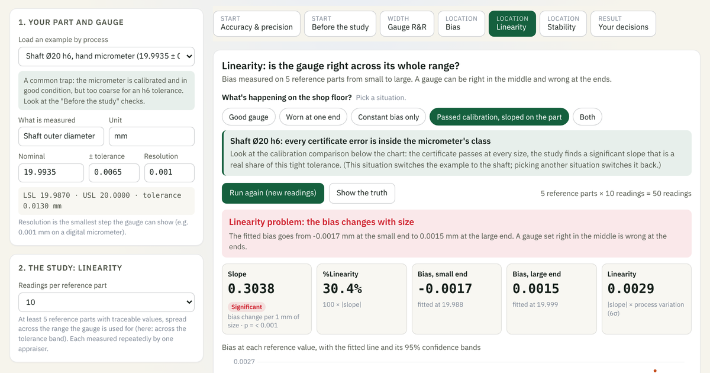

# MSA Simulator

A free, browser-based simulator for learning Measurement System Analysis by doing.
Set what is true about a gauge, run the study, and see what the study finds, and what it misses.

**Use it online:** https://kattamaipu.com/tools/msa/

## What you can do
- Load an example by process (crimp height, bore, shaft, flange, moulded wall, cast boss, CMM, and destructive tests: case depth, hardness, plating thickness, peel strength) or enter your own tolerance and resolution
- Change real shop-floor causes (worn fixture, unclear measuring point, different technique, temperature, wrong zero, uneven wear, drift) and see which result each one moves
- Location studies: bias (t-test and 95% interval), linearity (fitted line with confidence bands), stability (X̄ and R chart of a master)
- Width study: gauge R&R by the average and range method and by ANOVA, %GRR against total variation and against tolerance, ndc
- Destructive tests: batches in place of parts, with a shared-batch (crossed) or own-batch (nested ANOVA) design, and a split of what the study calls repeatability into the gauge and the material
- Attribute agreement for go/no-go gauges and visual inspection against limit samples: kappa, effectiveness, miss rate and false alarm rate, with strict, lenient and inconsistent inspectors
- Compare a calibration "pass" with what the bias and linearity studies find on the part
- See what a variable or an attribute gauge does to accept/reject decisions, with an optional guard band
- Step-by-step lessons for beginners, full controls for engineers, and a trainer mode for classroom use

## Run it yourself
It is a single HTML file with no dependencies and no tracking. Download `index.html` and open it in any modern browser, or use it in your own team sessions.

## Licence
© The Kattamaipu Company. Licensed under [Creative Commons BY-NC-SA 4.0](https://creativecommons.org/licenses/by-nc-sa/4.0/):

- **Free to use** for learning and in-company training, with credit to The Kattamaipu Company and a link to kattamaipu.com.
- **Not for resale**, and not for use in paid training or consulting by others without written permission.
- Changes must be shared under the same licence.

The study types follow the approach of the AIAG MSA reference manual. This is a learning tool, not validated MSA software: check important results independently before relying on them. Kattamaipu is independent and not affiliated with AIAG.

## Want your team to learn MSA properly?
In-plant MSA training, built around your own gauges and parts: https://kattamaipu.com/training/msa/
